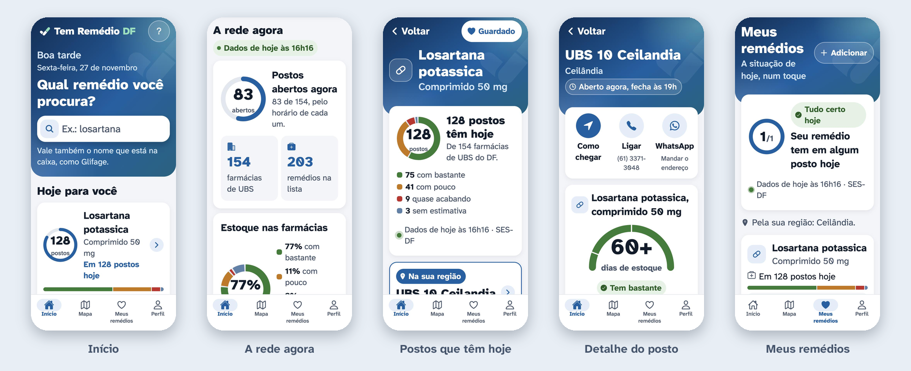
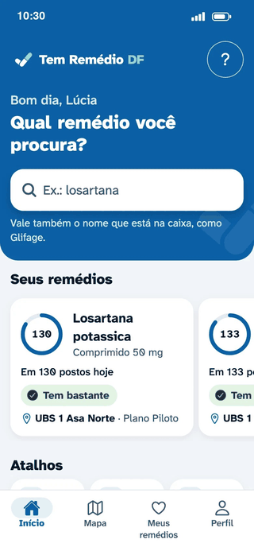
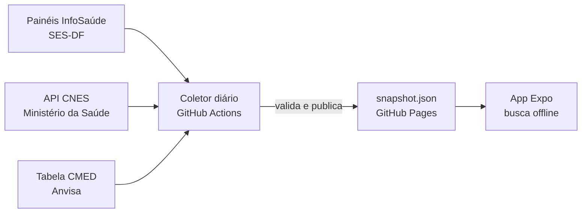

# Tem Remédio DF

> **"Em se tratando de medicamentos, a informação é o melhor remédio."**

App para idosos (e seus cuidadores) descobrirem **qual posto de saúde do DF tem o remédio hoje**, antes de sair de casa. Usa só dados públicos e oficiais da Secretaria de Saúde do DF.

Projeto de portfólio em React Native (Expo SDK 58) + TypeScript.

## Experimente

- **No navegador:** [vaotees.github.io/tem-remedio-df/app](https://vaotees.github.io/tem-remedio-df/app/). É a mesma base do app; na web o mapa dá lugar à lista dos postos.
- **No Android:** baixe o APK em [Releases](https://github.com/vaotees/tem-remedio-df/releases/latest) e abra no celular. O Android vai pedir para permitir a instalação de fora da Play Store.
- **No iPhone:** pelo navegador, no link acima. A versão da App Store depende da conta de desenvolvedor da Apple (o projeto já está configurado para o build).



<sub>Capturas da versão web (o mapa aparece só no app do celular), com o relógio às 17h30 para mostrar postos abertos. Dados reais da SES-DF.</sub>

<details>
<summary>Ver o fluxo animado (Início → painel da rede → postos → detalhe → Meus remédios → Perfil)</summary>



</details>

O processo de design e as decisões estão no [estudo de caso](https://emsolucoesdigitais.com.br/cases/tem-remedio-df). Para apresentar o projeto (pitch, roteiro de vídeo e perguntas de entrevista), veja [`docs/APRESENTACAO.md`](docs/APRESENTACAO.md).

Status: coletor de dados, busca → dose → postos mais perto → detalhe, mapa, Meus remédios, acessibilidade revisada (leitor de tela, letra grande, alvos de toque de 56) e redesenho visual (faixa da marca em todas as telas, painel da rede com gráficos animados, arco dos dias de estoque, abertura animada, Perfil sem cadastro). Antes das lojas faltam os itens de confiança da revisão de UX (aviso de versão, dado antigo, tela "Sobre").

## Como funciona



O coletor confere de hora em hora se a SES-DF atualizou (ela atualiza por volta de 00h15 e 16h15, horário de Brasília) e, quando há dado novo, publica um arquivo de ~120 KB (gzip) com:

- **156 farmácias de UBS** com endereço, coordenadas, telefone, horário e se entregam remédios controlados;
- **~200 remédios** da atenção básica, com forma, dose e **onde podem ser retirados** (qualquer UBS, UBS de referência, controlado...);
- **~1.000 nomes comerciais** ligados ao remédio do SUS (Glifage → metformina);
- **~18 mil itens de estoque** com **dias de estoque** estimados pelo consumo da própria UBS (semáforo).

O app só lê esse arquivo: não há servidor nem login, e nenhum dado de saúde do usuário sai do celular.

## Rodando

Requer Node 22.13+ ou 24.3+ (o `.nvmrc` usa o 24) e pnpm.

```bash
pnpm install
```

```bash
pnpm test
```

```bash
pnpm coletar
```

O último grava `pipeline/saida/snapshot.json` e `meta.json` a partir das fontes reais (~15 s).

### App

```bash
pnpm app
```

Leia o QR code com o **Expo Go** no celular, ou aperte `w` para abrir no navegador. O app já vem com um snapshot embutido e funciona sem internet; para buscar dados novos, copie `apps/mobile/.env.example` para `.env.local` com o endereço do GitHub Pages.

## Estrutura

| Pasta | O quê |
|---|---|
| `packages/shared` | Formato do snapshot (zod), semáforo, regras de retirada |
| `pipeline` | Coletor: Power BI → limpeza → tradutor de marcas → validação → publicação |
| `apps/mobile` | App Expo: Início com a busca, postos (lista e mapa), aba Mapa, Meus remédios, Perfil sem cadastro, tema acessível (contraste testado), snapshot embutido + cache |
| `scripts/montar-site.mjs` | Junta os dados e a versão web do app no site do GitHub Pages |
| `docs/SPEC.md` | Escopo, telas, regras e decisões |
| `spike/` | Teste de extração (M0) |

## Publicação

### Site (GitHub Pages)

O site tem os dados na raiz (`snapshot.json`, `meta.json`) e a versão web do app em `/app`. O GitHub Pages publica o site inteiro de uma vez, então o workflow `Coletor diário` sempre sai com os dois:

- **dado novo da SES-DF:** coleta, exporta o app e publica;
- **mudança no app na `main`:** pega os dados que já estão no ar, exporta o app e publica, sem coletar.

Na primeira vez: em *Settings → Pages*, escolha **GitHub Actions** como fonte e rode o workflow à mão (*Actions → Coletor diário → Run workflow*). Se a SES-DF não atualizou, ele não republica; se os dados vierem quebrados, rejeita e o snapshot anterior continua no ar.

### Celular (EAS Build)

Os perfis ficam em `apps/mobile/eas.json`; o identificador do app é `io.github.vaotees.temremediodf` (Android e iOS).

```bash
cd apps/mobile && npx eas-cli@latest build --platform android --profile preview
```

Gera um APK para instalar direto no Android (a chave de assinatura fica guardada no EAS). Para as lojas, o perfil `production` gera o pacote da Google Play (AAB) e o build de iOS; o iOS precisa da conta de desenvolvedor da Apple.

## Fontes dos dados

- [InfoSaúde DF](https://info.saude.df.gov.br) — painéis "Estoque de Medicamentos nas UBS" e "Como garantir seu medicamento" (SES-DF).
- [CNES](https://apidadosabertos.saude.gov.br) — cadastro de estabelecimentos de saúde (Ministério da Saúde).
- [CMED / Anvisa](https://dados.anvisa.gov.br/dados/) — tabela de preços de medicamentos (marca → substância).

A Lei 14.654/2023 obriga o SUS a divulgar o estoque das farmácias públicas. Os painéis são públicos, mas a forma de consulta usada pelo coletor não é uma API oficial e pode mudar.

## Aviso

O estoque é o registrado pela SES-DF na data indicada e muda ao longo do dia. **Ligue para a UBS antes de ir.** O app não substitui orientação médica ou farmacêutica.
