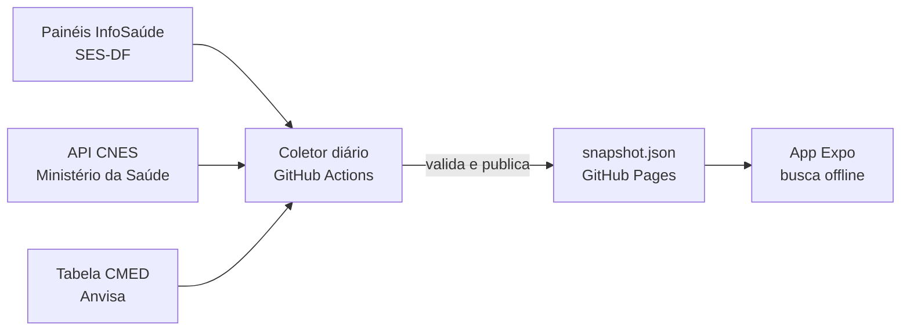

# Tem Remédio DF

> **"Em se tratando de medicamentos, a informação é o melhor remédio."**

App para idosos (e seus cuidadores) descobrirem **qual posto de saúde do DF tem o remédio hoje**, antes de sair de casa. Usa só dados públicos e oficiais da Secretaria de Saúde do DF.

Projeto de portfólio em React Native (Expo) + TypeScript. Status: **coletor de dados (M1), base do app (M2), fluxo principal (M3: busca → dose → postos mais perto → detalhe), mapa com escolha da região (M4) e Meus remédios (M5: lista guardada só no celular, com a situação de hoje de cada remédio) prontos**; acabamento (M6) em construção.

## Como funciona



O coletor roda duas vezes por dia (01:00 e 14:00, horário de Brasília) e gera um arquivo de ~120 KB (gzip) com:

- **156 farmácias de UBS** com endereço, coordenadas, telefone, horário e se entregam remédios controlados;
- **~200 remédios** da atenção básica, com forma, dose e **onde podem ser retirados** (qualquer UBS, UBS de referência, controlado...);
- **~1.000 nomes comerciais** ligados ao remédio do SUS (Glifage → metformina);
- **~18 mil itens de estoque** com **dias de estoque** estimados pelo consumo da própria UBS (semáforo).

O app só lê esse arquivo: não há servidor nem login, e nenhum dado de saúde do usuário sai do celular.

## Rodando

Requer Node 22+ e pnpm.

```bash
pnpm install
```

```bash
pnpm test
```

```bash
pnpm coletar
```

O último grava `pipeline/saida/snapshot.json` e `meta.json` a partir das fontes reais (~15 s).

### App

```bash
pnpm app
```

Leia o QR code com o **Expo Go** no celular, ou aperte `w` para abrir no navegador. O app já vem com um snapshot embutido e funciona sem internet; para buscar dados novos, copie `apps/mobile/.env.example` para `.env.local` com o endereço do GitHub Pages.

## Estrutura

| Pasta | O quê |
|---|---|
| `packages/shared` | Formato do snapshot (zod), semáforo, regras de retirada |
| `pipeline` | Coletor: Power BI → limpeza → tradutor de marcas → validação → publicação |
| `apps/mobile` | App Expo: busca, postos (lista e mapa), Meus remédios, tema acessível (contraste testado), snapshot embutido + cache |
| `docs/SPEC.md` | Escopo, telas, regras e decisões |
| `spike/` | Teste de extração (M0) |

## Publicação (GitHub Pages)

1. Em *Settings → Pages*, escolha **GitHub Actions** como fonte.
2. O workflow `Coletor diário` publica `snapshot.json` e `meta.json`. Rode-o uma vez à mão em *Actions → Coletor diário → Run workflow*.
3. Se a SES-DF não atualizou, ele não republica; se os dados vierem quebrados, rejeita e o snapshot anterior continua no ar.

## Fontes dos dados

- [InfoSaúde DF](https://info.saude.df.gov.br) — painéis "Estoque de Medicamentos nas UBS" e "Como garantir seu medicamento" (SES-DF).
- [CNES](https://apidadosabertos.saude.gov.br) — cadastro de estabelecimentos de saúde (Ministério da Saúde).
- [CMED / Anvisa](https://dados.anvisa.gov.br/dados/) — tabela de preços de medicamentos (marca → substância).

A Lei 14.654/2023 obriga o SUS a divulgar o estoque das farmácias públicas. Os painéis são públicos, mas a forma de consulta usada pelo coletor não é uma API oficial e pode mudar.

## Aviso

O estoque é o registrado pela SES-DF na data indicada e muda ao longo do dia. **Ligue para a UBS antes de ir.** O app não substitui orientação médica ou farmacêutica.
